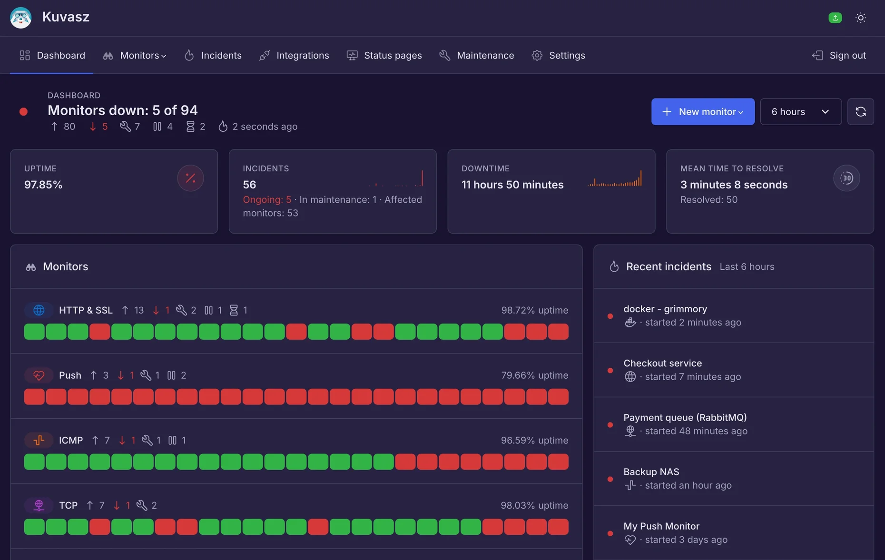

#

<figure markdown="span">
  { width="550" }
  { width="550" }
  <figcaption>Welcome to <strong>Kuvasz</strong> [ˈkuvɒs], an open-source, self-hosted uptime & SSL monitoring service with status pages, webhooks, an MCP server and IAC support!</figcaption>
</figure>

!!! tip "TL;DR"

    Do you want to try out _Kuvasz_ without installing it? There is a [**live demo**](demo.md) available!

    Are you looking for the **deployment guide**? You can find it [**here**](setup/installation.md)!

## Highlights

-   :material-binoculars:{ .lg .card-header-icon } __Monitor whatever you want__

    ---

    You can use _Kuvasz_ to monitor a wide variety of endpoints: HTTP, SSL, Docker, DNS, TCP, ICMP (ping), push (cron), just name it, and you're covered!

    [:octicons-arrow-right-24: Managing monitors](management/managing-monitors/index.md)

-   :muscle:{ .lg .card-header-icon } __Built to scale__

    ---

    **You can have 5 or 5,000 monitors, it doesn't make a difference!** _Kuvasz_ was built to perform in various scenarios, **up until 1,000 monitors** you'll be fine with the default configuration out of the box, and we have **official recipes** – _proved by actual benchmarks_ – for everything above that. 

    [:octicons-arrow-right-24: Sizing guide](setup/sizing.md)

-   :bell:{ .lg .card-header-icon } __Notifications__

    ---

    Supports multiple notification channels, currently including email, Slack (via a webhook or a bot), Discord, Telegram, Microsoft Teams, Apprise, Pushover, PagerDuty and custom webhooks. You can configure the notification channels on a per-monitor basis.

    [:octicons-arrow-right-24: Notifications](features/notifications.md)

-   :earth_africa:{ .lg .card-header-icon } __API__

    ---

    Provides a fully-fledged REST API to manage your monitors, check their status, and more.

    [:octicons-arrow-right-24: API](features/api.md)

-   :bar_chart:{ .lg .card-header-icon } __Metrics Exporters__

    ---

    Export your metrics to _Prometheus_ or to any _OTLP-compatible_ tool, to integrate with your existing monitoring and alerting systems.

    [:octicons-arrow-right-24: Metrics exporters](management/metrics-exporters.md)

-   :simple-homeassistant:{ .lg .card-header-icon } __Home Assistant__

    ---

    Kuvasz has an **official Home Assistant integration** that allows you to easily integrate your monitors into your smart home setup, create custom dashboards, and automate actions based on the status of your services.

    [:octicons-arrow-right-24: Home Assistant integration](home-assistant.md)

-   :octicons-law-16:{ .lg .card-header-icon } __Free & Open Source__

    ---

    Kuvasz is licensed under _AGPL-3.0_, it's free and it always will be.

    [:octicons-arrow-right-24: Sponsoring](https://ko-fi.com/L4L31DH59D)

-  :loudspeaker:{ .lg .card-header-icon } __Status Pages__

    ---

    You can create public and also private, brandable [status pages](https://demo.kuvasz-uptime.dev/status) for your monitors, to keep your customers or your internal team informed about the status of your services.

    [:octicons-arrow-right-24: Status Pages](features/status-pages.md)

-   :calendar:{ .lg .card-header-icon } __Maintenance Windows__

    ---

    Schedule planned downtime so Kuvasz pauses the affected checks and suppresses false alerts — manually, on a recurring cron schedule, or as a one-off event.

    [:octicons-arrow-right-24: Maintenance Windows](features/maintenance-windows.md)

-   :woman_cartwheeling:{ .lg .card-header-icon } __Flexible Configuration__

    ---

    You can choose how you would like to manage your monitors: on the UI, or via the API, or with a single YAML file.

    [:octicons-arrow-right-24: Flexibility](features/flexibility.md)

-   :cloud:{ .lg .card-header-icon } __Cloud Native__

    ---

    Kuvasz is built with cloud-native principles in mind, distributed as a single Docker image, and only requires a _PostgreSQL_ database to run.

    [:octicons-arrow-right-24: Getting started](setup/installation.md)

-   :robot:{ .lg .card-header-icon } __MCP server__

    ---

    Kuvasz ships with a built-in [**Model Context Protocol (MCP)**](https://modelcontextprotocol.io/) server, which exposes your monitoring data and management operations as **tools that AI assistants can call directly**. This lets you query monitor status, view incidents, and create or toggle monitors through natural language — right inside Claude, Cursor, or any MCP-compatible client.

    [:octicons-arrow-right-24: MCP server](features/mcp-server.md)

## Kuvasz vs. UptimeRobot

|                                      |    Kuvasz     | UptimeRobot Free | UptimeRobot Solo |
|--------------------------------------|:-------------:|:----------------:|:----------------:|
| Price                                |     Free      |       Free       |     $84/year     |
| Monitoring interval                  | **5 seconds** |    5 minutes     |    60 seconds    |
| Monitors limit                       | **unlimited** |        50        |        10        |
| Location-specific monitoring         |     ✅^1^     |        ❌        |        ✅        |
| Translations                         |      ✅       |        ❌        |        ❌        |
| Custom data retention                |      ✅       |     3 months     |    12 months     |
| REST API                             |      ✅       |        ✅        |        ✅        |
| OIDC                                 |      ✅       |        ❌        |        ❌        |
| Prometheus & OpenTelemetry exporters |      ✅       |        ❌        |        ❌        |
| Backups & YAML configuration         |      ✅       |        ❌        |        ❌        |
| Status pages                         |      ✅       |      only 1      |      only 3      |
| Maintenance windows                  |      ✅       |        ❌        |        ✅        |
| **HTTPs monitoring**                 |               |                  |                  |
| Keyword matching                     |      ✅       |        ✅        |        ✅        |
| Header matching                      |      ✅       |        ❌        |        ❌        |
| Slow response alerts                 |      ✅       |        ❌        |        ✅        |
| Custom HTTP methods                  |      ✅       |  ❌ (HEAD only)  |        ✅        |
| Custom status matcher                |      ✅       |        ❌        |        ✅        |
| Custom headers                       |      ✅       |        ❌        |        ✅        |
| Custom request body                  |      ✅       |        ❌        |        ✅        |
| **SSL monitoring**                   |      ✅       |        ❌        |        ✅        |
| **Heartbeat (push) monitoring**      |      ✅       |        ❌        |        ✅        |
| **Ping (ICMP) monitoring**           |      ✅       |        ✅        |        ✅        |
| **TCP monitoring**                   |      ✅       |        ✅        |        ✅        |
| **DNS monitoring**                   |      ✅       |        ❌        |        ✅        |
| **Docker container monitoring**      |      ✅       |        ❌        |        ❌        |
| **Domain expiration monitoring**     |      ❌       |        ❌        |        ✅        |
| **Notifications**                    |               |                  |                  |
| Email                                |      ✅       |        ✅        |        ✅        |
| Discord                              |      ✅       |        ✅        |        ✅        |
| Slack                                |      ✅       |        ❌        |        ✅        |
| Telegram                             |      ✅       |        ❌        |        ✅        |
| MS Teams                             |      ✅       |        ❌        |        ✅        |
| Apprise                              |      ✅       |        ❌        |        ❌        |
| Pushover                             |      ✅       |        ❌        |        ✅        |
| PagerDuty                            |      ✅       |        ❌        |        ❌        |
| Webhook                              |      ✅       |        ❌        |        ❌        |
| SMS / Voice call                     |     ✅^2^     |        ❌        |  10 incl./month  |
| Google Chat                          |     ✅^2^     |        ✅        |        ✅        |
| Mattermost                           |     ✅^2^     |        ❌        |        ✅        |
| Signal                               |     ✅^2^     |        ❌        |        ❌        |

✅ Supported | ❌ Not supported | 📆 Planned

- ^1^ You can deploy _Kuvasz_ to multiple locations and monitor your services from those locations, but it does not support location-specific monitoring out of the box.
- ^2^ via [custom webhooks](management/integrations.md/#webhooks) 

## Don't miss out on the latest updates!

First and foremost, if you want to **stay up-to-date with the latest news**, features, and updates about _Kuvasz_, please consider:

- starring the project on [**GitHub**](https://github.com/kuvasz-uptime/kuvasz) and on [**Docker Hub**](https://hub.docker.com/r/kuvaszmonitoring/kuvasz)
- following us on [**X**](https://x.com/KuvaszUptime)
- following us on [**Mastodon**](https://techhub.social/@KuvaszUptime){ target="_blank", rel="me" }

## Where does the name come from?

Kuvasz (pronounce as [ˈkuvɒs]) is an ancient hungarian breed of livestock & guard dog. You can read more about them
on [**Wikipedia**](https://en.wikipedia.org/wiki/Kuvasz).

## Do you like it?

While _Kuvasz_ is free and open-source, it still requires a lot of time and effort to maintain and develop. If you like it, please consider our [**sponsoring**](sponsoring.md) options.
